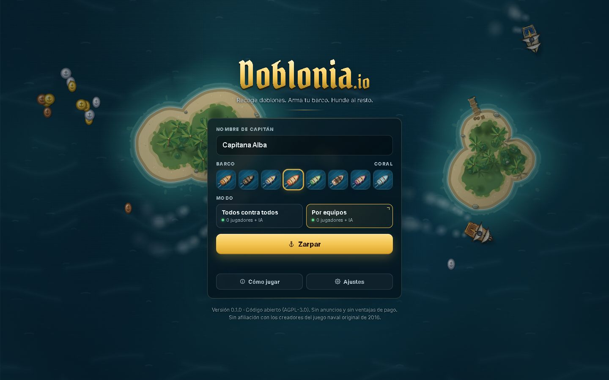

# Doblonia.io

Combate naval multijugador para navegador, con controles de teclado y ratón en PC y mandos táctiles en móvil. Recoge doblones, escoge una rama de armas y construye tu flota. El servidor calcula movimiento, daño, compras y recompensas.

Proyecto independiente inspirado en los juegos navales de navegador de 2016, sin afiliación con sus creadores. La primera versión pública está en preparación; consulta los criterios de salida en [el plan de publicación](docs/PLAN_DE_PUBLICACION.md) y las comprobaciones realizadas en [el registro de validación](docs/VALIDACION.md).



## Jugar en local

Necesitas Node.js **22.13 o posterior** y npm. Desde la raíz:

```sh
npm ci
npm run dev
```

Abre <http://localhost:5173>. El servidor utiliza el puerto 2567. Los dos modos se rellenan con bots hasta 16 barcos principales y admiten hasta 24 jugadores humanos por sala.

| PC                     | Acción                                      |
| ---------------------- | ------------------------------------------- |
| WASD / flechas         | Acelerar, frenar y girar                    |
| Ratón + clic / espacio | Apuntar y disparar                          |
| E / F                  | Auto-disparo / lanzar un doblón (cuesta 10) |
| 1–8                    | Comprar estadísticas                        |
| Z, X, C, V, B          | Elegir equipo disponible                    |
| 9, 0, T, Y             | Contratar flota                             |
| G / Esc / M            | Astillero / ajustes / silencio              |

En móvil, el mando izquierdo gobierna el barco y el derecho apunta y dispara. Las mejoras, flota, clasificación y ajustes están en la barra superior. El menú «Cómo jugar» explica la progresión y los peligros del mapa.

## Comprobar un cambio

```sh
npm run check
npm run format:check
npm audit
```

`check` ejecuta lint, tipos, pruebas de simulación y red, y compilación del cliente y servidor. No necesita un servidor abierto: la prueba de integración reserva un puerto libre. La revisión visual se hace en el navegador, en vertical y horizontal. Las pruebas físicas en Android/iOS siguen siendo parte de la salida de una versión.

Las [pruebas de lanzamiento](docs/PRUEBAS_DE_LANZAMIENTO.md) incluyen latencia y cortes de conexión, carga de varias salas, perfilado del navegador y la matriz de dispositivos físicos. `npm run test:network` puede ejecutarse sin preparar un servidor.

## Compilar y autoalojar

```sh
npm run build
npm start
```

Abre <http://localhost:2567>. Un único proceso sirve la web compilada y WebSocket. Puedes copiar `.env.example` a `.env` para configurar el puerto y los orígenes. `npm start` activa el entorno de producción. Para el servicio público utiliza HTTPS con un proxy que admita WebSocket. Consulta [despliegue](docs/DEPLOYMENT.md) para los límites y el contenedor.

La partida reside en memoria: reiniciar el servidor termina sus salas. Una desconexión temporal reserva el barco durante 20 segundos; una salida voluntaria lo retira. No hay cuentas, analítica ni guardado de progreso entre partidas. Las preferencias se guardan en el navegador.

## Estructura

| Directorio          | Responsabilidad                                  |
| ------------------- | ------------------------------------------------ |
| `packages/content`  | Armas, estadísticas, barcos, paletas y geometría |
| `packages/sim`      | Reglas y simulación sin navegador ni red         |
| `packages/protocol` | Estado sincronizado y contratos de mensajes      |
| `apps/server`       | Salas, validación, bots y sincronización         |
| `apps/client`       | PixiJS, interfaz, controles y sonido             |
| `scripts`           | Desarrollo, compilación y análisis de balance    |

Lee [arquitectura](docs/ARCHITECTURE.md) antes de cambiar la simulación o el protocolo. El arte y el sonido del juego se generan mediante código. Las fuentes se sirven localmente, sin peticiones a Google Fonts.

## Contribuir

Puedes proponer correcciones, contenido, ajustes de balance o mejoras visuales mediante una pull request. Los mantenedores revisan cada propuesta y deciden su incorporación; la partida oficial no carga código enviado por jugadores. [CONTRIBUTING.md](CONTRIBUTING.md) explica el proceso y [SECURITY.md](SECURITY.md) el tratamiento de vulnerabilidades.

La [configuración del repositorio](docs/REPOSITORIO.md) recoge la primera subida, revisión de contribuciones y activación del canal privado de seguridad.

## Licencia

El código del proyecto se distribuye bajo **AGPL-3.0-or-later**, según [LICENSE](LICENSE). Las fuentes y dependencias mantienen sus propias licencias; consulta [THIRD_PARTY_NOTICES.md](THIRD_PARTY_NOTICES.md). Antes de abrir el repositorio al público, sus responsables deben confirmar la titularidad del material original y configurar el enlace público al código fuente.
